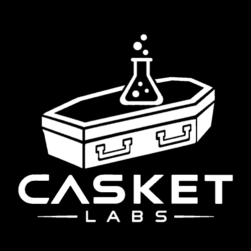

  

# PlayStation 2 — Projects

Homebrew projects for Sony PlayStation 2.

[← All systems](../../README.md) · [Add a project](../../RELEASE_TEMPLATE.md)

---

**Jump to:** [Games](#games) · [Game Ports](#game-ports) · [Applications](#applications) · [Tools and Utilities](#tools-and-utilities)

## Games

Original homebrew games.

*No projects listed yet.*

## Game Ports

Games brought to this system from another platform.

*No projects listed yet.*

## Applications

Standalone applications and creative software.

| Project | Description | Links |
| :--- | :--- | :--- |
| [Simple Media System](https://github.com/NathanNeurotic/Simple-Media-System) | Modernized PlayStation 2 multimedia player with expanded storage and network playback support. | [Download](https://github.com/NathanNeurotic/Simple-Media-System/releases) · [Source](https://github.com/NathanNeurotic/Simple-Media-System) |

## Tools and Utilities

Launchers, file managers, maintenance tools, and development utilities.

| Project | Description | Links |
| :--- | :--- | :--- |
| [FMCB Installer — Via Any Device](https://github.com/NathanNeurotic/FMCB-Installer-Via-Any-Device) | Modernized FreeMcBoot/FreeHdBoot installer that can launch from multiple PS2 storage devices. | [Download](https://github.com/NathanNeurotic/FMCB-Installer-Via-Any-Device/releases) · [Source](https://github.com/NathanNeurotic/FMCB-Installer-Via-Any-Device) |
| [FreeMcTuna](https://github.com/NathanNeurotic/FreeMcTuna) | Modified OpenTuna installer providing FreeMcBoot and PS2BBL-based boot configurations. | [Download](https://github.com/NathanNeurotic/FreeMcTuna/releases) · [Source](https://github.com/NathanNeurotic/FreeMcTuna) |
| [launcHER](https://github.com/NathanNeurotic/launcHER) | Standalone launcher for handing off to Ember from supported PS2 storage devices. | [Download](https://github.com/NathanNeurotic/launcHER/releases) · [Source](https://github.com/NathanNeurotic/launcHER) |
| [Launchstation](https://github.com/NathanNeurotic/Launchstation) | PlayStation 2 dashboard, file manager, executable launcher, and device toolkit. | [Download](https://github.com/NathanNeurotic/Launchstation/releases) · [Source](https://github.com/NathanNeurotic/Launchstation) |
| [POPSLoader](https://github.com/NathanNeurotic/POPSLoader) | Graphical PS1 game launcher for PS2 with POPStarter integration and storage-device support. | [Download](https://github.com/NathanNeurotic/POPSLoader/releases) · [Source](https://github.com/NathanNeurotic/POPSLoader) |
| [PS2-Servers](https://github.com/NathanNeurotic/PS2-Servers) | Desktop and headless SMB, HTTP, UDPBD, and UDPFS servers for PS2 homebrew. | [Download](https://github.com/NathanNeurotic/PS2-Servers/releases) · [Source](https://github.com/NathanNeurotic/PS2-Servers) |
| [PS2SP](https://github.com/johnson-cooper/PS2SP) | Community-maintained directory of PlayStation 2 software, tools, documentation, and resources. | [Source](https://github.com/johnson-cooper/PS2SP) |
| [RiptOPL](https://github.com/NathanNeurotic/Open-PS2-Loader) | Enhanced Open PS2 Loader with expanded device support, interfaces, and launching features. | [Download](https://github.com/NathanNeurotic/Open-PS2-Loader/releases) · [Source](https://github.com/NathanNeurotic/Open-PS2-Loader) |

---

This is a curated list of **completed, publicly released** projects. Want to suggest a missing Casket Labs project? Open an issue or pull request.

[← Back to all systems](../../README.md)
